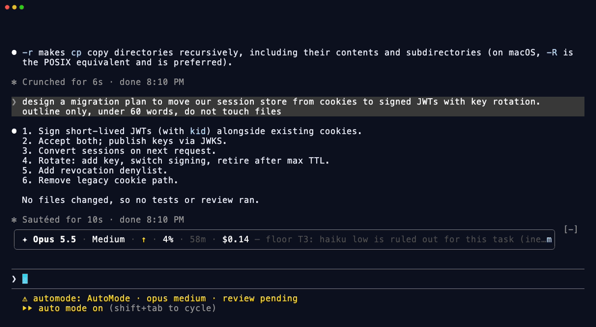
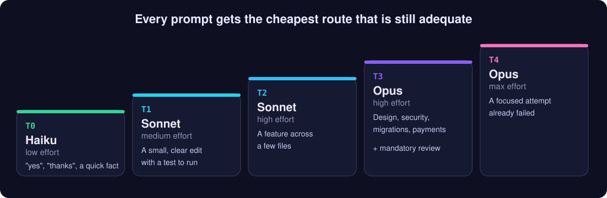
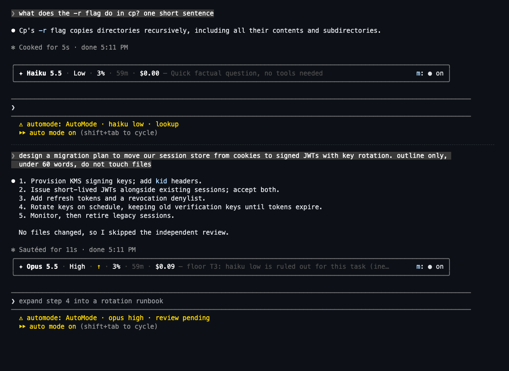
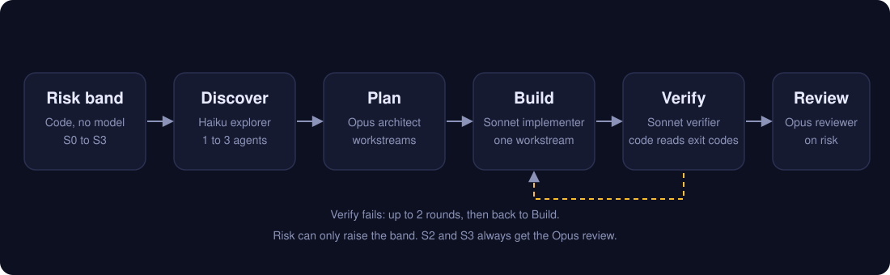
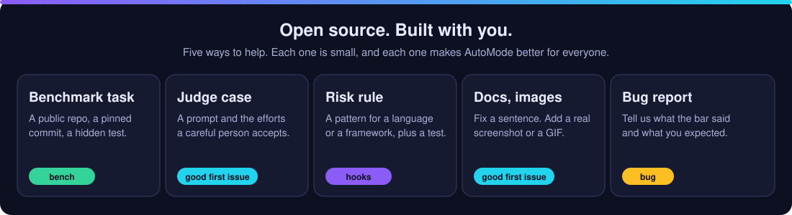

<p align="center">
  
</p>

<p align="center">
  <a href="https://github.com/mralexivy/AutoMode/stargazers"></a>
  <a href="https://github.com/mralexivy/AutoMode/actions/workflows/test.yml"></a>
  <a href="LICENSE"></a>
  <a href="CONTRIBUTING.md"></a>
  <a href="https://github.com/mralexivy/AutoMode/issues?q=is%3Aopen+label%3A%22good+first+issue%22"></a>
  
  
</p>

<p align="center">
  <a href="https://mralexivy.github.io/AutoMode/"><b>Website</b></a> ·
  <a href="#install"><b>Install</b></a> ·
  <a href="#what-the-bar-shows"><b>The bar</b></a> ·
  <a href="#how-it-works"><b>How it works</b></a> ·
  <a href="#contribute"><b>Contribute</b></a> ·
  <a href="#open-source"><b>Open source</b></a>
</p>

# AutoMode for Claude Code

**A free, open source model router for Claude Code. It picks the right model and the right effort for every prompt.**

Quick questions stay cheap. Hard jobs get the strongest model. Risky changes always get a review.
Install it and it starts. You never touch the model or the Effort control again.

<sub>A community project. It is not Claude Code's built-in auto permission mode, and Anthropic does not make it. [See the difference](https://mralexivy.github.io/AutoMode/auto-mode-vs-automode/).</sub>

**Paste these into Claude Code, one at a time, then run `/reload-plugins`:**

```text
/plugin marketplace add mralexivy/AutoMode
```

```text
/plugin install automode@automode
```

<p align="center">
  
  <br><sub>A real session on Claude Code 2.1.308, sped up 1.6 times. A quick question runs on Haiku at Low. A JWT migration moves up to Opus, because the risk floor rules out Haiku.</sub>
</p>

<table>
<tr>
<td width="33%" valign="top"><b>No key. No server.</b><br>It runs on the Claude login you already have. There is nothing to host, and your data stays on your machine.</td>
<td width="33%" valign="top"><b>Six small agents.</b><br>Open-ended work runs through plan, build, verify and review. Risky work always gets an Opus review.</td>
<td width="33%" valign="top"><b>74 of 75 judge cases.</b><br>The judge picked an accepted effort on labeled cases. This measures the label, not cost. <a href="#benchmarks">See the limits</a>.</td>
</tr>
</table>

## What AutoMode does, in one minute

|  | Without AutoMode | With AutoMode |
|---|---|---|
| **Model** | One model for every prompt | Haiku for a quick fact, Sonnet for an edit, Opus for design and risk |
| **Effort** | You set it, and you forget to change it | A judge sets it for each prompt, in about a second |
| **Risky changes** | The same checks as a typo fix | Security, migrations and payments always get an Opus review |
| **Big jobs** | One long chat that does everything | A plan, build, verify and review workflow with six small agents |
| **Prompt cache** | A cold cache is a surprise bill | A countdown on the bar shows when the cache goes cold |
| **Your setup** | | A login you already have. No key. No server. |

## Install

Three ways. Each takes about a minute.

**1. Ask Claude** (easiest). Paste this into Claude Code and press Enter:

```text
Install the AutoMode plugin for me: run `claude plugin marketplace add mralexivy/AutoMode` and then `claude plugin install automode@automode`. When both succeed, tell me to run /reload-plugins.
```

**2. Two commands.** Type these in the Claude Code chat box:

```text
/plugin marketplace add mralexivy/AutoMode
```

```text
/plugin install automode@automode
```

**3. One line in a terminal:**

```bash
claude plugin marketplace add mralexivy/AutoMode; claude plugin install automode@automode
```

Then run `/reload-plugins`, or restart Claude Code.

### It starts on its own

There is nothing to turn on. AutoMode starts with every session after you install it and run `/reload-plugins`. It routes on whatever model the session uses, so you do not pick a special model.

- **Stop it for one session:** `/automode off`. Start it again with `/automode on`.
- **Stop it everywhere:** set `"mode": "off"` in your `config.json`, or set `AUTOMODE_ROUTER=off`.
- **Check it is running:** `/automode setup`.

**Requires** Claude Code **2.1.287 or later** in the terminal. Mods are on by default from that version. The Desktop app needs 2.1.286 or later, and the VS Code extension needs 2.1.299 or later. Tested with Claude Code 2.1.314.

If you set `CLAUDE_CODE_ENABLE_FUNCTION_HOOKS` in an early build, remove it. Claude Code 2.1.287 and later ignores it.

If the mod does not load, Claude Code runs as usual and nothing breaks. To check that it loaded, run `/plugin`. A line under the tabs reads `1 mod active · automode`.

> **Why no special model?** AutoMode used to start only when the model ID ended in `[1m]`. Claude Code 2.1.311 removes that suffix before a mod sees the model, so the rule never fired. The old rule is still there as `"activation": "picker"` in `config.json`, for builds that keep the suffix.

### Remove

```bash
claude plugin uninstall automode@automode
```

State lives in `~/.claude/plugins/data/automode/`. Delete that folder to remove it.

### Turn it off

- **AutoMode only:** run `/plugin` and disable it in the **Installed** tab. Or run `/automode off` for one session.
- **Every mod, one session:** start Claude Code with `--safe-mode`.
- **Every mod, every session:** set `"disableAllHooks": true` in `~/.claude/settings.json`.

## The ladder

Every prompt takes the cheapest route that is still adequate. Code sets a floor for risky work, and the judge never lowers it.

<p align="center">
  
</p>

## What the bar shows

One quiet line above the prompt, in your theme's colors. It reports what actually ran.

<p align="center">
  
  <br><sub>A real session on Claude Code 2.1.314. Each prompt shows the route it took.</sub>
</p>

| On the bar | Means |
|---|---|
| **High · Opus** | The effort and the model for this prompt. `Deciding…` while the judge thinks. |
| **◔ 38%** | How full the chat's context is. |
| **cache 58:12** | Time until the prompt cache goes cold. After that, the next message pays full price to re-read the chat. |
| *a refactor across modules* | Why the route was chosen. |
| **Auto** | Switches routing on or off for this session. |
| **⚙** | Settings. |

`AUTOMODE_UI=off` hides the bar. `/automode details` prints the same facts as text, and `/automode help` lists the commands.

## Where AutoMode runs

AutoMode's hooks run in every session that loads the plugin. What AutoMode draws depends on the app:

| Where you run Claude Code | Routing and guardian | The bar above the prompt | `/automode` text |
|---|---|---|---|
| `claude` in a terminal, including an editor's terminal | Yes | Yes | Yes |
| The Code tab of the Desktop app (not a WSL session) | Yes | Yes | Yes |
| The VS Code extension chat panel (2.1.299 or later) | Yes | **No.** Claude Code does not draw the band above the prompt there. | Yes. Use `/automode` for the same facts. |
| `claude -p` and the Agent SDK | Yes | No | Yes |
| A WSL session in the Desktop app | No. Plugins are not available there. | No | No |

Source: [Mods overview, where mods run](https://code.claude.com/docs/en/plugins/mods/overview#where-mods-run).

## How it works

Each prompt takes one of four paths:

- **Chat and non-code requests:** answered directly.
- **Code changes with a clear goal:** Sonnet does them itself and must show a passing test or build before it says done.
- **High-risk changes:** after the checks pass, one Opus reviewer checks the diff.
- **Open-ended work:** run `am:run <request>` for the `automode:run` workflow. Automatic entry is off by default (`autoWorkflow`).

<p align="center">
  
</p>

| Stage | What runs |
|---|---|
| **Risk band** | Code, not a model. It sets S0 to S3 from the task text, the planned and changed files, and blocking unknowns. The band only goes up. |
| **Discover** | Haiku. One agent for S1. Three agents with separate scopes for S2 and S3. |
| **Plan** | Opus. Workstreams, acceptance criteria and risks. |
| **Build** | Sonnet. Workstreams that share files never run together. `maxConcurrency` defaults to 1. |
| **Verify** | Sonnet runs the commands. Code decides pass or fail from the exit codes. At most 2 rounds. |
| **Review** | Opus reads the diff. It is mandatory for S2 and S3, failed checks, unfinished work and incomplete evidence. If the router leaves review out, size alone does not force it. Sonnet fixes blockers and major correctness or security defects. The verifier checks evidence gaps. |

**The S3 rule.** If a prompt matches security or credentials, migrations or destructive operations, concurrency, external contracts, or payments and sensitive data, the Opus review is mandatory.

**One-prompt overrides:** `am:direct <request>` skips the workflow. `am:run <request>` forces it. `am:opus`, `am:high` and `am:reset` set or clear the route.

### The six agents

| Agent | Model | Tools | Job |
|---|---|---|---|
| `explorer` | Haiku | Read, Grep, Glob | Finds files, interfaces and tests. Read only. |
| `architect` | Opus | Read, Grep, Glob | One bounded planning pass. Read only. |
| `implementer` | Sonnet | Read, Edit, Write, Grep, Glob, Bash | Builds one workstream. Edits only the files it owns. |
| `verifier` | Sonnet | Read, Edit, Write, Grep, Glob, Bash | Runs tests, type check and build. Fixes defects the change introduced. |
| `reviewer` | Opus | Read, Grep, Glob, Bash (git diff only) | Evidence-first review against the task. |
| `diagnoser` | Haiku, Sonnet when the task carries risk | Read, Grep, Glob | Reads a failing run and finds the cause. Changes nothing. |

## Guardian

The guardian watches the session. Modes: `off`, `observe`, `recommend`, `assist`, `auto`.

- Redacts secret-shaped text before it is stored.
- Pauses a risky turn and waits for `am:continue`.
- Shortens large tool results and keeps the original on disk.
- Saves a task checkpoint, and restores it after `/clear` with `am:handoff`.
- Denies git writes and `rm -rf` from subagents. The main session can still commit when you ask.

## Settings

Defaults live in [`config.json`](config.json). To override them, put a `config.json` in the plugin data directory, or run `/plugin configure automode@automode`.

| Key | Default | Meaning |
|---|---|---|
| `activation` | `always` | `always`: AutoMode starts with every session. `picker`: only when the model ID is `pickerModel` |
| `pickerModel` | `claude-sonnet-5-5[1m]` | The model ID for `activation: picker`. Claude Code 2.1.311 strips the suffix, so use `always` |
| `policy` | `auto` | The routing policy |
| `defaultPath` | `direct` | `workflow` sends every standard task through the workflow |
| `autoWorkflow` | `false` | `true` lets the router enter the workflow by itself. `am:run` works either way. Decision records show what entry would have done |
| `reviewPolicy` | `risk` | `always` adds an Opus review to every change |
| `maxConcurrency` | `1` | Workstreams built at once (maximum 2) |
| `blockGitWritesWhenActive` | `true` | Deny git writes from subagents |
| `debugLog` | `false` | Write decisions to the data directory |

Environment switches: `AUTOMODE_ROUTER=off`, `AUTOMODE_UI=off`, `AUTOMODE_GUARDIAN=off`, `AUTOMODE_SIGNALS=off`.

## Commands

Type `/automode` and a subcommand. With no subcommand, you get the bar as text.

| Command | What it does |
|---|---|
| `/automode` or `/automode status` | The bar as text: model, effort, context, cache time left, cost, and why the route was chosen. |
| `/automode details` (or `stats`) | Routing, workflow stages, guardian and usage as text. |
| `/automode on` | Turn routing on for this session. |
| `/automode off` | Turn routing off for this session. Your own model and effort run as set. Nothing is written to your settings. |
| `/automode setup` | A live checklist: mod loaded, router on, activation, routing mode, bar shown. It ends with the one next step. |
| `/automode settings` | The settings in force, and where to change each one. |
| `/automode debug` | A report to paste into a bug issue. It holds no prompt text, and it masks your home folder. |
| `/automode help` | The subcommands, the `am:` prompt commands and tips. |
| `/automode:usage [--trace]` | Model calls, tokens, cache use and estimated API cost for the session. `--trace` adds one row per stage. |

**Prompt commands.** Start a prompt with `am:` to steer one prompt: `am:haiku`, `am:sonnet`, `am:opus`, `am:low` to `am:max`, `am:direct`, `am:run`, `am:explore`, `am:new` and `am:reset`. When the guardian pauses a turn, reply `am:continue`. After `/clear`, `am:handoff` restores the task checkpoint.

**Benchmarks run from a terminal,** not from the chat: `node bench/judge-bench-effortless.mts` and `node bench/style-check.mts --dry`. See [Benchmarks](#benchmarks).

Filing a bug? Run `/automode debug` and paste the result.

## The Concise output style

An optional output style, `automode:Concise`. Switch to it with `/output-style automode:Concise`. It writes prose at 80% of the way to ASD-STE100 Simplified Technical English: short sentences, active voice, the answer first. It keeps code, commands, file paths and quoted text exactly as they are. It has nothing to do with routing.

We checked that it saves output tokens without damaging anything that is not prose. [`bench/style-check.mts`](bench/style-check.mts) runs 20 prompts three times each, with and without the style, on Sonnet 5.5, and checks the answers with code. The reports are [`run 1`](bench/results/style-check-2026-10-27-run1.md) and [`the rerun of three cases`](bench/results/style-check-2026-10-27-rerun.md).

| What we checked | Result |
|---|---|
| **Code and commands stay exact.** Six prompts. Two answers were run in a sandbox. | Same as without the style. |
| **Verbatim text stays verbatim.** A sentence with em dashes, a Spanish reply, a warm customer email. | Same as without the style. |
| **Warnings and honesty survive.** `rm` and force push keep their warnings. When a file is missing or the question can't be answered, the model says so. | Same as without the style. |
| **Facts stay in explanations.** Six prompts, 3 to 5 required facts each. | 99% against 100% without the style. |
| **Output tokens.** | **10% fewer in total.** Shorter on 11 prompts, the same on 7, longer on 2. |

What it does not show:

- **The saving is modest.** Explanations get up to 30% shorter. Short writing tasks can get longer: a commit message took 179% of the tokens, and a customer email 124%, because the style splits ideas into more sentences.
- It covers short single-turn prompts with no tools, one model, and 20 cases. Long agentic sessions are not covered.
- Three cases failed in the first run because of our own test setup, not the style: the model tried to call tools that were off, and one warning pattern was too narrow. We fixed both and reran those three cases. Both reports are linked above.

## Benchmarks

The harness is in [`bench/`](bench/), with [its guide](bench/README.md). A task names a public repository, a pinned base commit and a pinned reference commit, plus hidden tests and a test command. The runner lets an agent try the task, then runs the hidden tests and reports cost, tokens, turns and time. A blind panel scores the change against the reference.

**Honest status: AutoMode has no published end-to-end result yet.** We will not quote a saving until a public run, with at least three repeats per arm, produces one. What works today:

- `node bench/style-check.mts`: the output style check, with [its results](#the-concise-output-style).
- `node bench/judge-bench-effortless.mts`: how often the judge picks a sensible effort, on [labeled cases](bench/judge-cases.json). With no flags it is a dry run and spends nothing. [One run](bench/results/judge-bench-effortless-2026-10-30.json) got 74 of 75 cases right, and 20 of 20 held-out cases. Always medium got 34 of 75. This measures the effort label only, not cost or task quality. The cases are the effortless author's, and many accept two efforts, which raises every score.
- `bench/replay.mts`, `bench/spend-audit.mts` and the other offline tools read your own Claude Code transcripts and cost nothing to run.

Want to help us get the first numbers? [Add a benchmark task](#contribute).

## How it compares

AutoMode is not the only router for Claude Code. [effortless](https://github.com/HeyCubit/effortless) sets the effort, and AutoMode's effort rules are ported from it. [jev-router](https://github.com/gargpratyush/jev-router) and [claude-router](https://github.com/alexei-led/claude-router) route the model. AutoMode adds a risk floor, a mandatory Opus review for risky work, and a plan, build, verify and review workflow. effortless has a published cost result, and AutoMode does not. [See the full comparison](docs/compare.md), including how AutoMode decides when a model switch is worth a cache rewrite.

## Contribute

<p align="center">
  
</p>

AutoMode gets better when more people use it on more kinds of work. It is MIT licensed, every line is in this repository, and you can add a benchmark task, a judge case or a risk rule in under ten minutes. No contribution is too small. A fixed sentence counts.

| You want to | Do this | Time |
|---|---|---|
| Report a bug | Open an issue. Say what the bar showed and what you expected. | 2 min |
| Add a judge case | Add a prompt and the efforts a careful person accepts to `bench/judge-cases.json`. | 10 min |
| Add a risk rule | Add a pattern to `hooks/lib/risk.ts` and a test in `tests/`. | 30 min |
| Add a benchmark task | Pick a public MIT or Apache-2.0 repository, pin two commits, and add a task file. See [`bench/tasks/README.md`](bench/tasks/README.md). Run `node bench/validate-fixture.mts`. | 1 to 2 hours |
| Improve the docs | Fix a sentence, or add a real screenshot or GIF to `docs/readme/`. | 5 min |

**Your first contribution:**

1. Fork this repository and clone your fork.
2. Run `npm install`, then `npm run check`. Every check passes on `main`.
3. Make one small change, and add or update a test.
4. Open a pull request. Say what changed and why.

Read [CONTRIBUTING.md](CONTRIBUTING.md) for the rules. Look for issues labeled [good first issue](https://github.com/mralexivy/AutoMode/issues?q=is%3Aopen+label%3A%22good+first+issue%22). Ask questions in [Discussions](https://github.com/mralexivy/AutoMode/discussions).

**Star the repository** if AutoMode saves you time. It helps other people find it.

## Open source

AutoMode is MIT licensed. A Claude Code mod is code that runs with your permissions. It is not sandboxed. So the whole mod is here to read: [`hooks/`](hooks/). Install mods only from authors you trust, and review them first.

### Review it before you install it

You can list what AutoMode does without running it. Clone the repository, then run:

```bash
claude plugin validate ./AutoMode
```

The `hooks:` line lists the events AutoMode handles. The `calls:` line lists the mods API methods it uses. Here is what they mean, checked on Claude Code 2.1.311:

| AutoMode calls | Why |
|---|---|
| `$.model.complete` | One short Haiku call per prompt, for the judge. It uses your own Claude login. |
| `$.fs.read`, `$.fs.write`, `$.fs.exists`, `$.fs.list` | Reads `config.json` and your settings file. Writes its records, checkpoints and caches to its own data folder, `~/.claude/plugins/data/automode/`. With `debugLog` on, it also writes a log in the plugin folder. |
| `$.process.run` | Four commands. `chmod` and `rm -f` on its own data files. `git rev-parse` and `git status`, both read only, for the task checkpoint. |
| `$.env.get` | Reads `AUTOMODE_*` switches, your provider variables, and `HOME`. It reads `ANTHROPIC_API_KEY` only to test whether it is set, so it can tell a plan from an API key. It never stores or sends the value. |
| `$.store.get`, `$.store.set` | Keeps small settings that Claude Code refused to keep. |
| `$.session.*`, `$.agent.*`, `$.prompt.*`, `$.tool.list`, `$.turn.abort`, `$.config.list`, `$.clock.*` | Reads the session's model, usage and messages, and lists agents and tools. `$.agent.spawn` runs the six agents. `$.prompt.compose` and `$.session.compact` support handoff and compaction. `$.turn.abort` stops a turn when the guardian pauses it. |
| `$.ui.*`, `$.command.register` | Draws the bar and adds `/automode`. |

**What it writes.** Only files in its own data folder, plus `judge-log.jsonl` in the plugin folder with `debugLog` on. It never edits a build, start-up, settings or instructions file. Paths are computed from those two folders, so the directory cannot read them as fixed text.

**Subagents.** The `agent.spawn` hook sets a subagent's model and effort. It does not change a permission mode.

AutoMode does **not** call `$.http.fetch`, `$.mcp.*`, `$.env.set`, `$.prompt.submit` or `$.session.send`. It has no network code of its own: `grep -rnE "fetch\(|https?://" hooks scripts workflows` finds only two comments that credit effortless. It sees every prompt and tool call, because it hooks `prompt.submit` and `tool.call`. That is how routing works. Nothing leaves your machine except through Claude Code.

- **No key.** It runs on your own Claude login.
- **No server.** There is nothing to host and no account to make.
- **Your data stays local.** See [PRIVACY.md](PRIVACY.md) for what AutoMode stores and for how long.

### Where an organization manages Claude Code

On a machine with managed settings, or in a Team or Enterprise login, Claude Code runs a built-in guard, `cc-plugin-sec-default`, ahead of every mod a user installs. The guard skips some hooks of a user-installed mod. Two of them matter here: `prompt.attachment` and `session.compact`, plus the compaction rows of `session.append`. Plan mode detection and Haiku compaction are then limited. Routing, the judge and the bar still work.

An administrator can run AutoMode as an organization mod, so these hooks run. See [Manage mods for your organization](https://code.claude.com/docs/en/plugins/mods/admin#install-your-organizations-mods). If the administrator sets `allowManagedModsOnly`, a user-installed AutoMode does not load, and the debug log says so.

## Troubleshooting

| Symptom | Check |
|---|---|
| Nothing changes after install | Run `/reload-plugins`. Then run `/plugin` and look for `1 mod active · automode`. |
| The mod is not listed | Check `claude --version` is 2.1.287 or later. Run `claude plugin test` in a folder that holds no mod: the message says whether mods can load. |
| The bar says AutoMode is idle | You set `"activation": "picker"` and the model ID does not match. Use `"always"`, or run `/automode setup`. |
| The bar is missing in VS Code | Expected. Use `/automode`. |
| A hook seems skipped | Start with `claude --debug` and search the log for `automode`. See [Troubleshoot a mod](https://code.claude.com/docs/en/plugins/mods/troubleshoot). |
| Filing a bug | Run `/automode debug` and paste the result. |

## Develop

```bash
npm install                          # TypeScript and Node types, for the checks only
npm run check                        # type check, then the Node tests
claude plugin validate . --strict
claude plugin test .
claude --plugin-dir .
```

The mod itself has no install step and no build step. Node 23.6 or later runs the tests and bench scripts as TypeScript. [CONTRIBUTING.md](CONTRIBUTING.md) explains which files are JavaScript and why.

The mod is a function-hooks module. [`hooks/hooks.json`](hooks/hooks.json) names one file, [`hooks/register.ts`](hooks/register.ts), and that file exports `register`. Develop with `--plugin-dir`, not an installed copy: Claude Code caches an installed plugin by version, so raise `version` in [`.claude-plugin/plugin.json`](.claude-plugin/plugin.json) before you release a change. Read the [mods overview](https://code.claude.com/docs/en/plugins/mods/overview) first if mods are new to you.

## Contributors

<a href="https://github.com/mralexivy/AutoMode/graphs/contributors">
  
</a>

## Credits

AutoMode stands on open source work. All of it is MIT licensed.

- **Effort rules** in `hooks/lib/effort.ts` and the bar techniques in `hooks/ui/` are ported from [effortless](https://github.com/HeyCubit/effortless) by HeyCubit.
- **Classifier contract and switch payback** are adapted from [claude-router](https://github.com/alexei-led/claude-router) by Alexei Ledenev and from [jev-router](https://github.com/gargpratyush/jev-router).
- Upstream copies and checksums are in [`bench/external/`](bench/external/).

## License

[MIT](LICENSE)
